<p align="center">
  
</p>

# NearRecurrences.jl

Near recurrences of a simulation, searched as the simulation runs. A near recurrence is a pair of
states, a start and an end a time T later, where the trajectory comes back close to where it was,
up to the symmetries of the system. Each one is the first guess of a Newton search for a periodic
orbit. The package takes one sample at a time and never stores the trajectory. It keeps the last
samples in a ring buffer, three rows of distances per window of periods, and the candidates not
yet decided. It hands each recurrence over while its stretch is still in the buffer, so that the
shooting points of a search are the simulation's own states, bit for bit.

The system stays with you. You advance the simulation, you give the distance of two states with its
symmetries, and you write what you keep. The package is the loop between the two, with no
dependency. The mathematics, with its derivations, is in
[`notes/recurrence-search.pdf`](notes/recurrence-search.pdf).

**Contents.**
[Installation](#installation) ·
[A near recurrence](#a-near-recurrence) ·
[The search as a stream](#the-search-as-a-stream) ·
[The interface](#the-interface) ·
[The seeds](#the-seeds) ·
[The Lorenz system](#the-lorenz-system) ·
[Symmetries and shifts](#symmetries-and-shifts) ·
[The invariant bound](#the-invariant-bound) ·
[The probability of a distance](#the-probability-of-a-distance) ·
[Kuramoto–Sivashinsky](#kuramotosivashinsky) ·
[Kolmogorov flow](#kolmogorov-flow) ·
[Tests](#tests) ·
[A guide to the code](#a-guide-to-the-code)

## Installation

The package is not registered. Add it from its repository, or develop it from a local copy of its
folder.

```
julia -e 'using Pkg; Pkg.add(url="https://github.com/Davide-Lasagna-s-Lab/NearRecurrences.jl")'
julia -e 'using Pkg; Pkg.develop(path="path/to/NearRecurrences.jl")'
```

The examples share one environment, `examples/Project.toml`, with CairoMakie for the figures. They
are run from the folder of the package.

```
julia --project=examples -e 'using Pkg; Pkg.instantiate()'
julia --project=examples examples/lorenz/search.jl
```

## A near recurrence

A simulation advances a state $u$ and is sampled every $\Delta s$, sample $k$ at the time
$(k - 1)\Delta s$. The system may have symmetries $S(s)$, continuous or discrete, that commute with
the flow, with $s$ the vector of their shifts. The distance of a start $u(t)$ and an end
$u(t + T)$ is

$$
d(t, T) = \min_s \frac{\lVert S(s)\, u(t + T) - u(t) \rVert}{\lVert u(t) \rVert} .
$$

It vanishes when the end is a shifted copy of the start, that is on a periodic orbit of period $T$
relative to the shift $s$. It is small when the trajectory passes near such an orbit.

<p align="center">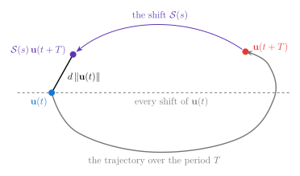</p>

*The trajectory leaves $u(t)$ and comes back close to a shifted copy of it after a time $T$. The
shift that brings the end closest to the start leaves the distance $d$, which a search reduces to
zero.*

A near recurrence is a pair of samples where $d$ is a local minimum in the plane $(t, T)$ and lies
below a threshold. A pass near an orbit makes a valley of $d$ in that plane, and its deepest point
is the best guess the pass offers. The threshold comes from a probability, the fraction of the pairs
closer than $d$, which the search measures (see [below](#the-probability-of-a-distance)).

Of two minima whose starts and periods both differ by `apart` at most, only the closer is kept. Their
stretches share most of their trajectory. They are two loops along one pass near an orbit, or one
short orbit followed over several periods, so they repeat one guess. Two starts closer than a few
Lyapunov times lie on nearly the same trajectory, since a difference of the starts grows at the
leading exponent. A few Lyapunov times is thus the natural `apart`.

## The search as a stream

The periods are searched in windows. A window holds the lags from $\ell_{lo}$ to $\ell_{hi}$ samples,
and $h$ is the longest lag of all the windows. The row of the start sample $i$ holds its distances
to the samples at the lags of the window. Every row of the start $i$ is complete once the sample
$i + h$ has come, so the new sample $k$ completes the row of the start $k - h$ in every window, one
distance per lag. All the windows hold the rows of the same starts.

<p align="center">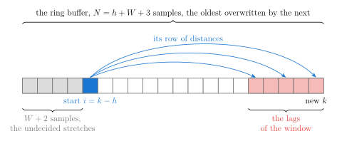</p>

*The ring buffer, drawn with $h = 15$ and $W = 2$. The new sample $k$ completes the row of the start
$i = k - h$, its distances to the samples at the lags of the window. The $W + 2$ samples before the
start hold the stretches of the candidates not yet decided.*

Three rows are kept per window, those of the starts $i - 2$, $i - 1$ and $i$. An entry of the middle
row is a candidate if it lies below the threshold of its window and below its eight neighbours. The
first and the last lag of a window lack the neighbours on one side, and they are never candidates.

With $W$ the number of samples of `apart`, two candidates are close if their starts differ by $W$ at
most and their lags too, in any windows. A candidate is kept unless a close one comes before it in
the order of (distance, start, lag, window). Of two close candidates the one of smaller distance is
thus kept and the other is dropped, whatever their windows and their shifts, and two kept ones are
never close. The rule depends on the candidates alone, not on the order in which they come.

<p align="center">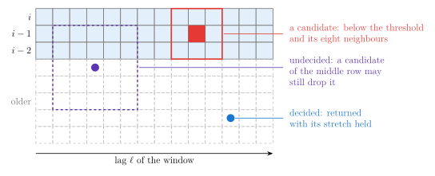</p>

*The rows of one window, drawn with $W = 2$, the start down the page and the lag across. Three rows
are stored, and the older ones keep only their candidates. A candidate within $W + 1$ rows of the
middle row is undecided, since a candidate of the middle row may still be close to it.*

A candidate of the start $s$ depends on the candidates of the starts $s - W$ to $s + W$. These have
all come once the middle row has reached $s + W + 1$, since a later candidate starts at the middle
row or after it. The sample $k$ thus decides the candidates of the start $k - h - 2 - W$, and
`push!` returns those kept. The candidates of every window are decided in step with the longest
window. So a recurrence of a short window becomes final some $h$ samples after its stretch has come.

The length of the buffer follows from the stretches. A recurrence decided at the sample $k$ starts at
$k - h - 2 - W$, and its stretch reaches at most $k$. The buffer thus holds

$$
N = h + W + 3
$$

samples. The next sample overwrites the start of the oldest stretch, which is held exactly until
then. `apart` may exceed the width of a window. It only delays the decisions and lengthens the
buffer.

The memory does not grow along a run. The candidates held start within $2W + 2$ rows, and being
minima below the threshold they are few. Their vector grows only when they outnumber all those held
before. The recurrences decided by one sample are not close to one another, so their lags differ by
more than $W$, and their vector is given the capacity of that bound once.

Two windows that touch, $(T_{lo}, T_1)$ and $(T_1, T_{hi})$, share the lag of $T_1$. It is the last
lag of one and the first of the other, so a minimum there is a candidate of neither. Windows that
overlap by two lags or more find it, and the rule of the closest keeps it once, in the window of
lower index.

## The interface

```julia
import NearRecurrences

R = NearRecurrences.Recurrences(x, distance;
                                spacing   = 0.1,                    # time between two samples
                                windows   = [(19, 21), (190, 210)], # periods searched, (lowest, highest)
                                threshold = 0.118,                  # one number, or one per window
                                apart     = 30.0,                   # the closer of two minima this close
                                invariant = nothing)                # optional, see below

for k in 1:steps
    advance!(x)                          # your simulation, one sample ahead, x changed in place

    for r in push!(R, x)                 # the recurrences that this sample makes final
        g = NearRecurrences.seeds(R, r, m)
        # g.states[1:m] shooting points, g.states[m + 1] the end of the stretch, g.offsets in samples
    end
end

rest = NearRecurrences.finish!(R)        # the recurrences still undecided when the stream stops
NearRecurrences.probability(R, 0.05)     # the fraction of the pairs compared closer than 0.05
```

`x` is a sample, an array or a type with `copy` and `copyto!`. The buffer holds copies of it, and
the k-th call of `push!` is sample k, at the time `(k - 1)*spacing`. The lags of a window are
`round(Int, lo/spacing)` to `round(Int, hi/spacing)`, both included, and `apart` is rounded to
samples the same way. Rounding, not truncation, matters, since `0.3/0.1` falls just below 3. After
the constructor every index is a count of samples.

`distance(a, b)` returns the distance of the start `a` and the end `b`, minimised over the
symmetries of the system, as many as it has, continuous and discrete. It returns a number, or a
tuple `(d, s₁, s₂, …)` with the shifts that reach it, as `(d, σ, sy)` for a shift along x and a
translation along y. A recurrence is the named tuple

```
(t, T, d, shifts, window, start, lag)
```

with the time of the start, the period, the distance, the shifts, the index of the window, and the
start and the lag in samples. Its stretch, the samples from its start to its end, stays in the
buffer until the next `push!`. So does the vector that `push!` returns, which the next call
empties, so that a run allocates nothing. Copy the recurrences to keep them, as
`append!(list, push!(R, x))` does.

The choices have their reasons.

- **One buffer for all the windows.** The trajectory is integrated once whatever the number of
  windows, and every stretch is held, at the price of $N$ states in memory. A stream per window
  would hold less but would integrate again for each window and keep no stretch.
- **The loop is yours.** `push!` returns the recurrences made final while their stretches are
  held, so the seeds are copied from the buffer in place, and only those asked for. An iterator
  over the recurrences would have to copy every stretch.
- **The rule of the closest acts across the windows.** Windows of long periods touch, and two minima
  on either side of a common edge repeat one guess as much as two minima within a window do.
- **The rows hold distances only.** A recurrence takes its shifts from one more call of `distance`
  when it is kept, which is rare.
- **The bound is a keyword.** Any invariant of the symmetries serves, and a test can check it on
  every pair.

## The seeds

A search by multiple shooting cuts the stretch into $m$ segments, from the shooting points
$u_1, \dots, u_m$. Its first residual has the interior junctions $\varphi(u_i) - u_{i+1}$ and the
closing junction $S\,\varphi(u_m) - u_1$, with $\varphi$ the flow over a segment and $S$ the shift of
the recurrence. Let the shooting points be samples, and let each segment repeat the steps of the
simulation from its point to the next. The interior junctions then vanish, and the closing junction
is $S\,u(t + T) - u(t)$, of norm $d\,\lVert u(t)\rVert$. The search starts from the recurrence and
nothing else.

`seeds(R, r, m)` copies samples from the buffer. Segment $j$ goes from the offset $o_j$ to
$o_{j+1}$ after the start, in samples,

$$
o_j = \mathrm{round}\big((j - 1)\,\ell/m\big), \qquad j = 1, \dots, m + 1 ,
$$

with $\ell$ the lag, so that $o_1 = 0$ and $o_{m+1} = \ell$. Consecutive values differ by $\ell/m$
and rounding moves each by half a sample at most, so a segment spans $\ell/m$ samples, or its floor
or its ceiling. With $\ell = 10$ and $m = 4$ the offsets are 0, 2, 5, 8 and 10. Nothing is
interpolated or advanced. `seeds` throws once the stretch has left the buffer.

The seeds are exact only if the search advances each segment by the steps of the simulation. An
integrator covers a span by steps of its `dt` and ends it with a step that lands on the end of the
span, shorter when the span is not a whole number of steps, as the stepper of Flows.jl does. A seed
advanced over a segment of $n$ samples then comes back in three ways.

| advanced by | the next seed | the closing junction |
|---|---|---|
| $n$ calls over `spacing`, as the simulation | bit for bit | $d$ exactly |
| one call over $n$ `spacing`, a sample a whole number of steps | to rounding, $10^{-15}$ | $d$ to $10^{-15}$ |
| one call over $n$ `spacing`, a sample not a whole number of steps | off by $10^{-10}$ to $10^{-8}$ | off by up to $10^{-8}$ |

*The test "the seeds and the steps of the integrator", on the Lorenz system with steps of 0.005 and
samples of 10 and of 10.5 steps. In the last case the short steps fall at other times, so a segment
follows another discretisation, and the first residual of a search is no longer the recurrence.*

The rule is thus simple. A sample is a whole number of time steps of the integrator, and the search
takes the offsets in samples and advances each segment by a whole number of steps. The time of a
segment, its offsets times `spacing`, is then a label only.

## The Lorenz system

The examples run on the Lorenz system at $\sigma = 10$, $\rho = 28$, $\beta = 8/3$, sampled every 0.05
by five steps of the classical Runge–Kutta scheme, for the periods from 0.5 to 4 below the distance
0.1, along $10^4$ time units. The leading Lyapunov exponent is near 0.9.
[`examples/lorenz/search.jl`](examples/lorenz/search.jl) searches with the distance
$\lVert u(t + T) - u(t)\rVert/\lVert u(t)\rVert$, three times on one stream, with `apart` of 0, 0.5
and 5 time units, none, half a Lyapunov time and some four.

```julia
R = NearRecurrences.Recurrences(x, distance; spacing = 0.05, windows = [(0.5, 4.0)],
                                threshold = 0.1, apart = 5.0)
for k in 1:200_000
    advance!(x)                                   # five steps of 0.01
    for r in push!(R, x)
        g = NearRecurrences.seeds(R, r, 4)       # four segments
    end
end
```

The stream has 40 494 minima below 0.1 in $10^4$ time units. The rule keeps 22 776 of them with
`apart` 0.5 and 982 with `apart` 5. A narrow rule thus keeps the neighbours along one valley, which
repeat one guess, and a rule of a few Lyapunov times keeps one per pass.

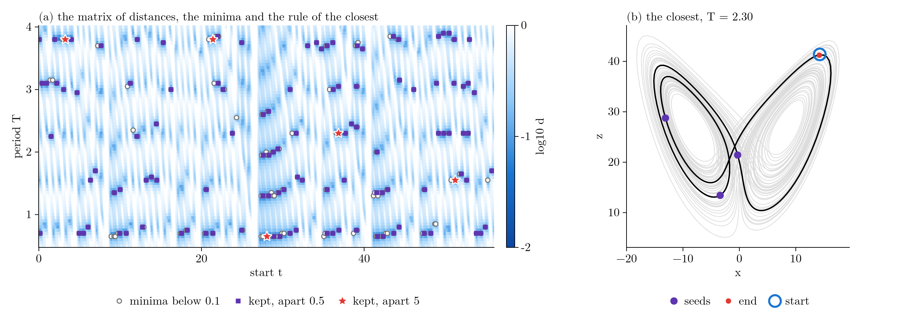

*(a) The matrix of $\log_{10} d$ over the start and the period, the first 60 time units, with its
minima below 0.1 and those that the rule of the closest keeps with `apart` 0.5 and 5. The valleys
run along the periods of the orbits that the trajectory follows for a while. (b) The closest
recurrence with `apart` 5, in the plane $(x, z)$, with the seeds of four segments.*

## Symmetries and shifts

`distance` minimises over all the symmetries at once, and the search sees the minimum alone. A near
recurrence is then a local minimum of the distance already minimised over the symmetries, and it
carries the shifts of its own pair. Its neighbours may reach their minima at other shifts. The rule
of the closest compares distances alone, so of two close minima with different discrete shifts the
smaller is kept and the other is dropped. The seeds close on one another with the shifts of the
recurrence.

The Lorenz system does not change under the rotation $R(x, y, z) = (-x, -y, z)$ by $\pi$ about the
$z$ axis. [`examples/lorenz/symmetry.jl`](examples/lorenz/symmetry.jl) takes the distance up to it,
the smaller of $\lVert b - a\rVert$ and $\lVert R b - a\rVert$ over $\lVert a \rVert$, and returns
the rotations $r$ of $b$ that reach it.

```julia
function rotated(a, b)
    d₀ = norm(b - a)
    d₁ = norm([-b[1], -b[2], b[3]] - a)
    return d₁ < d₀ ? (d₁/norm(a), 1) : (d₀/norm(a), 0)
end
```

Of the 990 recurrences of $10^4$ time units, 434 close after the rotation. A recurrence with $r = 1$ closes after the rotation, as the two halves of a
symmetric orbit do. This is the small model of Kolmogorov flow, whose distance minimises over a
continuous shift along x and a discrete translation along y and returns both.

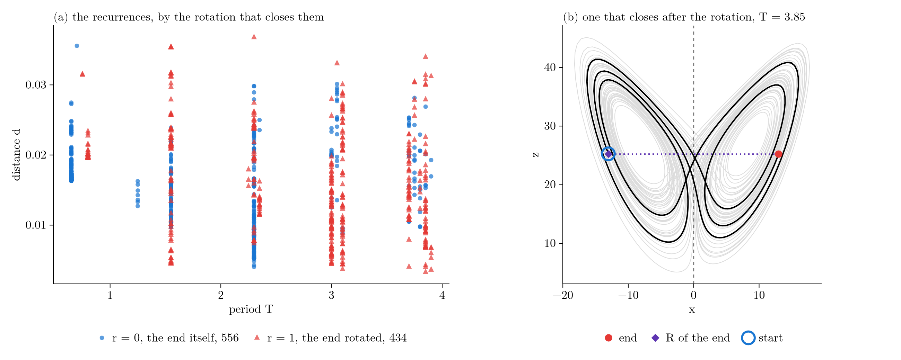

*(a) The recurrences, by the rotation that closes them. (b) The closest of those that close after
the rotation, in the plane $(x, z)$, where the rotation is the mirror $x \to -x$ (dashed). Its end,
rotated, lies near its start.*

## The invariant bound

Most pairs lie far above the threshold, and a cheaper quantity can tell them apart before the
minimum over the shifts. An invariant is a real array $v(u)$ with three properties. The symmetries
leave it unchanged, $v(S u) = v(u)$. It does not stretch distances,
$\lVert v(a) - v(b)\rVert \le \lVert a - b\rVert$. And it keeps the norm,
$\lVert v(a)\rVert = \lVert a\rVert$. For every symmetry $S$ the first two give

$$
\lVert v(b) - v(a)\rVert = \lVert v(S b) - v(a)\rVert \le \lVert S b - a\rVert ,
$$

so $\lVert v(b) - v(a)\rVert$ is at most the minimum over $S$. Divided by
$\lVert v(a)\rVert = \lVert a\rVert$ this is the bound

$$
\beta(a, b) = \frac{\lVert v(b) - v(a)\rVert}{\lVert v(a)\rVert} \le d(a, b) .
$$

The package normalises $\beta$ by the norm of the invariant of the start, as $d$ is normalised by the
norm of the start. So `invariant` must return an array whose 2-norm is the norm of the state in the
distance, or the bound fails.

For the rotation of the Lorenz system $v = (\sqrt{x^2 + y^2},\ z)$. The rotation changes the signs
of $x$ and $y$ and leaves $\sqrt{x^2 + y^2}$ alone. The reverse triangle inequality gives
$\big|\lVert(x_b, y_b)\rVert - \lVert(x_a, y_a)\rVert\big| \le \lVert(x_b, y_b) - (x_a, y_a)\rVert$, so $v$ does
not stretch distances, and $\lVert v\rVert^2 = x^2 + y^2 + z^2$. For a field in Fourier space
shifted along a periodic direction, $v$ holds the moduli of its coefficients, weighted so that the
2-norm of $v$ is the norm of the field. A shift changes the phases alone, and
$\big||b_k| - |a_k|\big| \le |b_k - a_k|$ mode by mode.

With `invariant = v`, a pair whose $\beta$ is not below the threshold is not passed to `distance`,
and its entry holds $\beta$. The recurrences are the same. Such an entry is at or above the
threshold, as its distance is. It is no candidate, and it lies above any candidate among its
neighbours, as its distance does, since a candidate is below the threshold. The package keeps the
invariant of every sample of the buffer and computes $\beta$ by its own loop, which allocates
nothing. [`examples/lorenz/invariant.jl`](examples/lorenz/invariant.jl) searches up to the rotation
with the bound and without it. Both find the same 990 recurrences, and the bound passes
652 229 of the $1.4 \times 10^7$ pairs to `distance`, so 95 per cent are skipped.

<p align="center">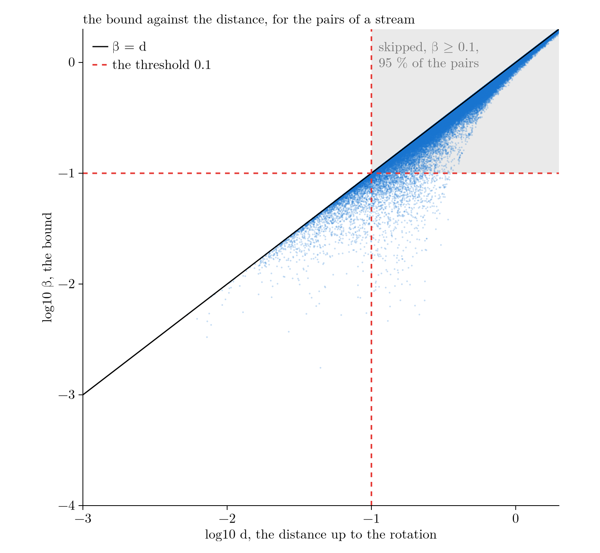</p>

*The bound against the distance for the pairs of every tenth start of 1000 time units, all below
the diagonal. The pairs with $\beta \ge 0.1$ (shaded) are not compared in full, the fraction given
over $10^4$ time units.*

The bound pays where the distance costs more than a pass over the invariant. On the
Kuramoto–Sivashinsky equation of the tests, whose distance minimises over a shift and a reflection
by a scan of 128 shifts, a pair costs 2.9 μs in full and 0.36 μs with the bound, which passes 14
per cent of the pairs (`Pkg.test()` prints these numbers). For Kolmogorov flow, fewer than eight pairs in a thousand pass the
bound at the threshold of $p = 10^{-6}$, and a pair costs a tenth of a full distance.

## The probability of a distance

The rows hold the distance of every pair at the lags of the windows, so the search measures the
correlation integral $C(d)$, the fraction of the pairs closer than $d$, as it goes. Each window
counts its pairs, `R.pairs[w]`, and bins $\log_{10} d$ of the distances below its threshold, in bins
of width 0.01 from $-2$, `R.counts[w]` with the edges `R.edges[w]`. The first bin also holds the
distances below $10^{-1.99}$. With the bound, a pair with $\beta$ at or above the threshold counts as
a pair but is not binned. Every pair closer than the threshold has $\beta \le d$ below it, so it is
compared in full and binned, and the histogram is the same.

`probability(R, d)` pools the windows. At an edge, $d = 10^{-1.99}, 10^{-1.98}, \dots$ up to the
smallest threshold, it is exact. Between two edges it is the fraction closer than the edge below, a
distance smaller by 2.3 per cent at most. Runs with the same thresholds add their counts bin by bin
and their pairs. [`examples/lorenz/probability.jl`](examples/lorenz/probability.jl) draws $C$ over
$10^5$ time units and its levels on the recurrences. $C$ reaches 0.01 at $d = 0.058$,
0.003 at 0.033 and 0.001 at 0.021.

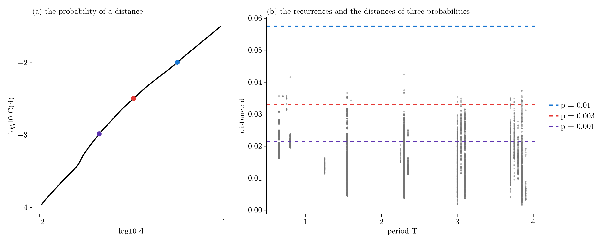

*(a) The fraction $C(d)$ of the pairs closer than $d$, at the lags from 0.5 to 4. (b) The distance
against the period of the recurrences, with the distances $d_p$ where $C$ reaches three
probabilities.*

## Kuramoto–Sivashinsky

[`examples/ks/ks.jl`](examples/ks/ks.jl) searches the Kuramoto–Sivashinsky equation on a periodic
domain of length 22, the system of the tests, with 15 Fourier modes, the classical Runge–Kutta
scheme on the linear part taken exactly, steps of 0.025 and a sample every 0.25. The distance
minimises over the shift along $x$ and the reflection $u(x) \to -u(-x)$, one continuous symmetry and
one discrete, and returns `(d, σ, r)`. The invariant is the weighted moduli of the modes. Over
$5 \times 10^4$ time units, for the periods from 8 to 40 below 0.15, with `apart` 90, some four
Lyapunov times at the leading exponent near 0.04, the stream finds 266 recurrences, 122 of them
closing after the reflection. The bound skips 96 per cent of the pairs. In the tests a pair costs
2.9 μs in full and 0.3 μs with the bound.

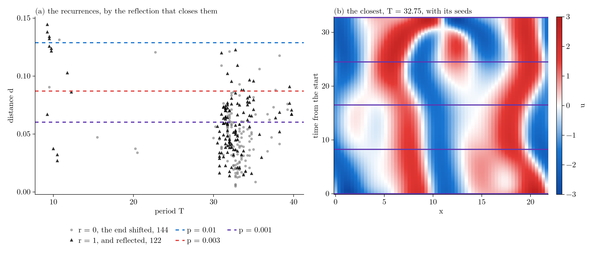

*(a) The distance against the period of the recurrences, by the reflection that closes them, with the
distances where the probability reaches three levels. (b) The stretch of the closest recurrence,
$T = 32.75$ and $d = 0.005$, as $u(x, t)$ over the domain and the time from its start, with its four
seeds (purple lines).*

<p align="center">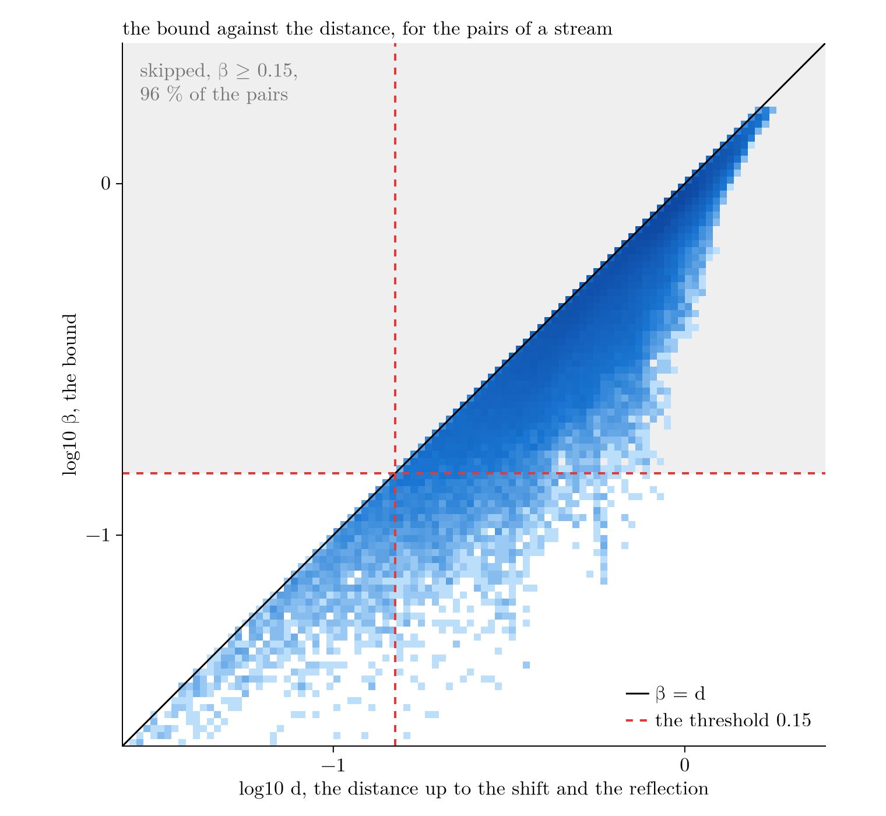</p>

*The bound against the distance for the pairs of every tenth start of 2000 time units, as a density,
all below the diagonal, with the threshold 0.15 and the fraction of the pairs that the stream skips.*

## Kolmogorov flow

The search of long orbits of Kolmogorov flow runs on this package. Its distance minimises over the
shift along $x$ and the translations along $y$ by whole wavelengths of the forcing, as Chandler &
Kerswell (2013, §3.2) do, and returns both. For each translation $\lVert S b - a\rVert^2$ is a
trigonometric polynomial in the shift, so one FFT and a few Newton steps give the minimum. The
moduli of the coefficients are the invariant. `Distance` and `moduli` are those of
BatchedKolmogorovFlow.jl.

```julia
import NearRecurrences
import BatchedKolmogorovFlow
import Random
import Serialization

n, m, Re, kf = 33, 49, 40.0, 4                              # modes, grid of 100², Re, forcing
G = BatchedKolmogorovFlow.NonlinearPropagator(n, m, Re, kf; B=1, dt=0.01)

x  = Random.randn!(BatchedKolmogorovFlow.FTFields(n, 1))    # a smooth random field
x .= x ./ (1 .+ x.j.^2 .+ x.k.^2)
BatchedKolmogorovFlow.apply_symmetry!(x)
G(x, 500.0)                                                  # the transient

R = NearRecurrences.Recurrences(x, BatchedKolmogorovFlow.Distance(n, kf);  # (d, σ, sy)
                                spacing   = 0.1,                           # ten steps
                                windows   = [(19, 21), (173, 245), (1414, 2400)],
                                threshold = 0.118,
                                apart     = 30.0,
                                invariant = BatchedKolmogorovFlow.moduli)

for k in 1:10^7
    G(x, 0.1)                                                # one sample, ten steps
    for r in push!(R, x)
        g = NearRecurrences.seeds(R, r, max(1, round(Int, r.T/10)))   # segments near 10
        Serialization.serialize("r$(r.start)-$(r.lag).jls", (r, g))
    end
end
```

A sample is ten steps of 0.01, a whole number, as [the seeds](#the-seeds) require. `apart` is 30 time
units, about four Lyapunov times at the leading exponent 0.13, since two minima closer than that
repeat one guess. Each recurrence carries its shift and its translation, `r.shifts == (σ, sy)`.

[`examples/kolmogorov/bound.jl`](examples/kolmogorov/bound.jl) runs this set-up over 2000 time units,
for the windows 19 to 21 and 95 to 105 below 0.118 with `apart` 30, and
[`examples/kolmogorov/figure.jl`](examples/kolmogorov/figure.jl) draws its bound. They run apart,
since CairoMakie brings a second FFT package whose plans make those of FFTW ambiguous in the
propagator.

```
JULIA_LOAD_PATH="@:path/to/NearRecurrences.jl:@stdlib" \
    julia --project=path/to/BatchedKolmogorovFlow.jl/examples examples/kolmogorov/bound.jl
julia --project=examples examples/kolmogorov/figure.jl
```

The bound passes 139 of the $2.3 \times 10^6$ pairs to the distance. On one core of a laptop a bound
costs 1.4 μs and a distance 6.7 μs. The stream finds no recurrence, as the counts below predict,
fewer than one per $10^5$ time units in these bands at the threshold of $p = 10^{-6}$.

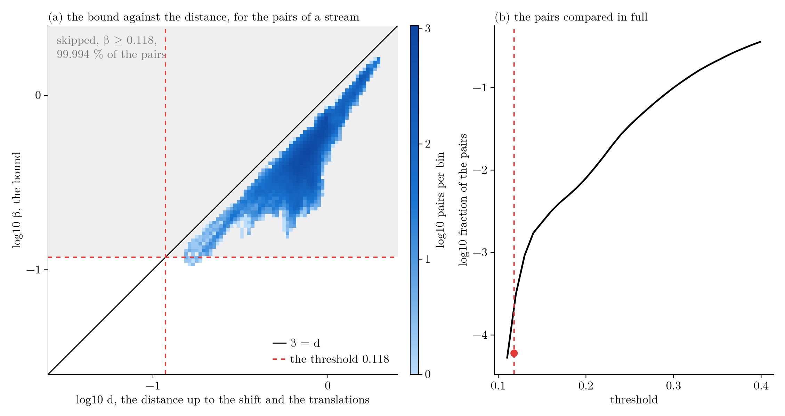

*(a) The bound against the distance up to the shift and the translations, for the pairs of every
fifth start of 500 time units, as a density. All lie below the diagonal, and those above the
threshold 0.118 (shaded) are not compared in full, the fraction given over the stream. No pair of the
sample lies below the threshold. (b) The fraction of the pairs compared in full against the
threshold, the stream at 0.118 marked.*

The counts of recurrences follow two rules. The count in a band $T \pm 5$ per cent grows as $T$,
since the band is $0.1\,T$ wide and a unit of width collects nearly the same number. It falls with
the distance as $d^{\mu}$, $\mu \approx 6$, two powers more slowly than the correlation integral. A
recurrence is a minimum, and near one of depth $d_0$ the pairs closer than $d$ fill an area of the
plane $(t, T)$ that grows as $d^2 - d_0^2$, so $C \propto d^{\mu + 2}$.

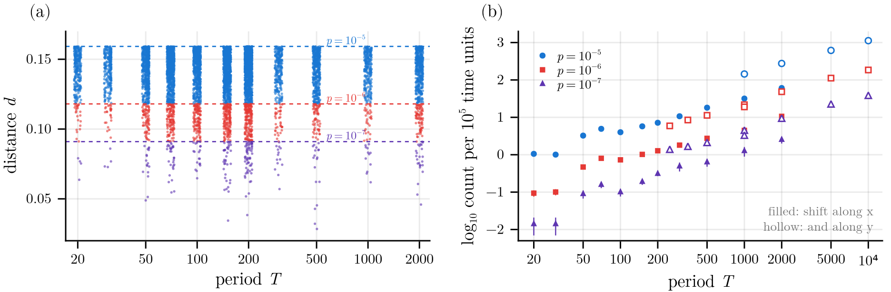

*(a) The distance against the period of 7128 recurrences of Kolmogorov flow at $Re = 40$, with the
shift along $x$ alone, and the distances of three probabilities. (b) The recurrences per $10^5$ time
units in a band $T \pm 5$ per cent, along $x$ alone (filled) and with the translations along $y$
(hollow). From [`notes/fig_counts.jl`](notes/fig_counts.jl) and the tables of `notes/data/`.*

## Tests

```
julia --project=. -e 'using Pkg; Pkg.test()'
NEARRECURRENCES_LONG=1 julia --project=. -e 'using Pkg; Pkg.test()'
```

The first runs every check on short streams, in under a minute. The second runs the heavy cases in
full, the Kuramoto–Sivashinsky stream of $10^4$ samples and the long stream of $5 \times 10^5$, and
takes some minutes.

The tests run on systems written in the test with fixed steps of a Runge–Kutta scheme, the Lorenz
system with and without its rotation, and the Kuramoto–Sivashinsky equation on a domain of length 22
with its shift and its reflection, one continuous symmetry and one discrete. The reference is written
plainly from the whole trajectory, its matrices of distances by blocks of starts, its candidates by
the eight neighbours, and its rule of the closest over all the candidates sorted by start. Each test
guards against one way the search could go wrong.

- **The ring buffer.** Ten samples through four slots, the samples held after the wrap, a
  `BoundsError` for a sample that has left or not come, and a copy on `push!`. It guards against
  reading an old slot for the sample asked.
- **The windows in samples.** Periods that do not divide exactly, `0.3/0.1` and `0.7/0.1`, give
  the lags 3 and 7, both included, and `apart` rounds the same way. It guards against a window or a
  rule one sample short.
- **Lorenz, two windows.** $2 \times 10^4$ samples against the reference, with a threshold per
  window and `apart` wider than the first window, equal in every field. Every recurrence starts at
  the first sample held, and the next `push!` takes its stretch away, so the buffer is neither short
  nor long. The seeds of 1, 3, 7 and all the segments are the samples bit for bit, each segment
  repeats the steps of the simulation, and the first and the last state give the distance. Some
  candidates of one window are dropped for close ones of the other. The histograms and
  `probability` agree with the reference at every edge.
- **Kuramoto–Sivashinsky, a shift and a reflection.** 4000 samples, $10^4$ in the long run, the distance
  minimised over a continuous and a discrete symmetry and returned as `(d, σ, r)`, with the invariant
  and without it. The same recurrences, shifts and histograms as the reference, both reflections
  among them, and the shifts close each stretch to its distance. It guards the two shifts and the
  bound, and it prints the cost per pair.
- **A long stream.** $2 \times 10^4$ samples of Lorenz with its rotation, $5 \times 10^5$ in the
  long run, some 18 and 450 wraps of the buffer, five windows of 11 to 201 lags with a threshold each, two of them touching and two
  overlapping, and `apart` wider than all but the longest. Equal to the reference built by blocks.
  `push!` allocates only when the candidates outnumber all those before, a few times in all. The
  common lag of the touching windows holds no candidate of either, while one window over both has
  candidates there. A pair in two overlapping windows is one recurrence. The rule drops minima for
  close ones of the other rotation. A replay of the stored samples gives the same recurrences in the
  same order, the same seeds bit for bit and the same state of the search. It guards a run of days.
- **The seeds and the steps of the integrator.** Lorenz advanced over spans by steps of 0.005 and a
  last step that ends the span, with samples of 10 and of 10.5 steps, with the rotation and without
  it. It checks the three ways of the table of [the seeds](#the-seeds), and it guards against the
  trap of a span that is not a whole number of steps.

## A guide to the code

| file | what it holds |
|---|---|
| [`src/NearRecurrences.jl`](src/NearRecurrences.jl) | the module and its exports |
| [`src/ringbuffer.jl`](src/ringbuffer.jl) | `RingBuffer`, the last samples indexed by their number in the stream |
| [`src/recurrences.jl`](src/recurrences.jl) | `Recurrences`, `push!`, `finish!`, `probability`, then the row, the minima and the decision of a sample |
| [`src/seeds.jl`](src/seeds.jl) | `seeds`, the offsets and the copies |
| [`notes/recurrence-search.tex`](notes/recurrence-search.tex) | the mathematics, with `fig_counts.jl` and its tables in `data/` |

Every file opens with what it holds and the mathematics it follows. Read the top of
`recurrences.jl` first, the distance, the rows, the candidates, the rule of the closest, the length of
the buffer, the memory, the bound and the probability. The diagrams are drawn by
`bash assets/make_diagrams.sh` from their TikZ sources in `assets/diagrams/`, and the logo by
`julia --project=. assets/make_logo.jl`. The note is built in `notes/` by
`tectonic recurrence-search.tex`.

## Reference

- G. J. Chandler and R. R. Kerswell, *Invariant recurrent solutions embedded in a turbulent
  two-dimensional Kolmogorov flow*, J. Fluid Mech. **722**, 554–595 (2013).
